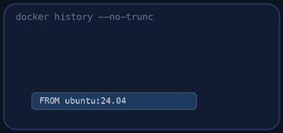
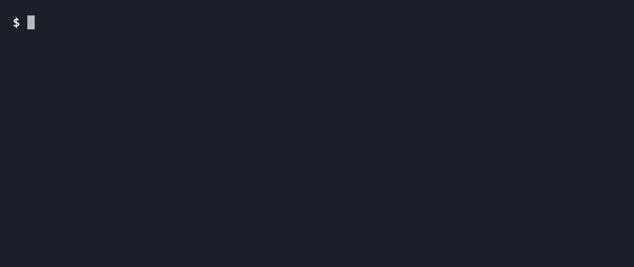
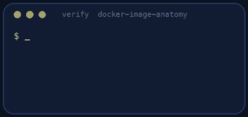
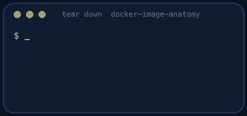

<p align="center"></p>

| | |
|-|-|
| **Time** | 90-105 min |
| **Cost** | free on your own machine |
| **You need** | Docker, git, curl, Python 3 and a terminal (on Windows use WSL) |

## How this lab works

1. **Fork** this repository to your own GitHub account (button at the top right).
2. Clone **your fork** in your Ubuntu environment (WSL on Windows, your OrbStack machine on Mac).
3. Read the lab below (the same text is in [`LAB.md`](LAB.md)) and follow the mission.
4. Answer the questions in [`SUBMISSION.md`](SUBMISSION.md). Where a question asks for output, paste it in a code block. No screenshots needed.
5. Commit and push. Open the **Actions** tab of your fork (click *I understand my workflows, go ahead and enable them* the first time). The **Lab check** shows what is still missing.
6. When the check is green, **submit the URL of your fork** in the course platform.

> [!NOTE]
> The check only looks at your answers and any files the lab asks you to commit. Your instructor reads your work and may ask you to explain any line.

<p align="center"></p>

## 🎬 The situation

<p align="center"></p>

Your company is being acquired. The buyer's security engineer, who has been reading your repositories all week, opened one pull request and assigned **you** to review it, because you are the one who knows Docker.

```text
Pull request #212                                         status: changes requested
Title      : Keep legacy-pollie:1 in the production registry "as is"
Author     : previous platform team (now at another company)
Reviewers  : you (assigned), the buyer's security engineer

  author  > The image is fine. The registry token was removed in the Dockerfile:
            "RUN python -c ... && rm /app/.env"  see line 8. Can we merge?
  security> It is 1.9 GB and takes four minutes to pull. And I want proof about
            the token before this goes anywhere near the deal. Evidence only.
```

The previous team says the secret is gone. The buyer says prove it. You will find out, using nothing but `docker` and `tar`, because the point of this lab is to understand what an image **physically is**. Then you will replace the Dockerfile with one that cannot have this problem.

> [!IMPORTANT]
> **Your mission**
> - Read the image's history like a crime scene
> - Unpack it and find the token with your own eyes
> - Record your findings in `findings.json` (the checker knows the truth)
> - Write a production `Dockerfile.fixed`: smaller, non-root, with no secret in any layer
> - Tear down and prove it

**Time:** 90-105 min | **Cost:** free | **You need:** Docker, git, curl, Python 3 and a terminal. On Windows use WSL.

<p align="center"></p>

## Round 0 - Check out the pull request

Fork this repository, clone your fork and run `./setup.sh`. It clones Pollie, **plants a random token** in `secrets/registry.env` and builds the legacy image from `Dockerfile.legacy`. Read `Dockerfile.legacy` first, as the previous team wrote it, and review it line by line before you run anything else: which lines worry you, and why? The token is different on every machine, so nobody can copy an answer.

<p align="center"></p>

## Round 1 - Read the history

<p align="center"></p>

```bash
docker images legacy-pollie:1
docker history legacy-pollie:1
docker history --no-trunc legacy-pollie:1
```

Each row is one instruction and the **layer** it produced, with its size. Find the layer that copied `registry.env`, the one that "deleted" it, and the largest one.

> [!NOTE]
> **Predict** Layers are stacked, read-only filesystem changes. When a later layer runs `rm /app/.env`, what does it add to the stack: a deletion marker on top of the old file, or does it edit the layer below? What does that mean for the bytes in the layer below? Write your answer as a review comment on line 8 before you go on.

<p align="center"></p>

## Round 2 - Unpack it (the evidence)

An image is a set of tar files plus JSON. Take it apart:

```bash
mkdir work && docker save legacy-pollie:1 -o work/legacy.tar
tar -xf work/legacy.tar -C work
cat work/index.json | python3 -m json.tool | head -30
ls work/blobs/sha256 | head
```

Follow `index.json` to the manifest, the manifest to the **config** (environment, user, command, history) and to the list of **layers**. Then search the layers for the token's name:

```bash
for f in work/blobs/sha256/*; do tar -tf "$f" 2>/dev/null | grep -H --label="$f" registry.env; done
```

Extract the layer that contains it and read the file. That is the secret, still there. Also look at the layer that contains the deletion: you will find a *whiteout* file, a marker that hides the file in the merged view but does not remove it from the layer below.

> [!NOTE]
> **Think** Anyone who can `docker pull` the image can do what you just did. A registry that is "private" is private only until the first person with read access copies the image elsewhere. What does that make the *right* order of response: rotate, clean, or both?

<p align="center"></p>

## Round 3 - Write up the findings

Fill in `findings.json` (every field is a fact you can read from `docker history`, `docker image inspect` or the layers): the base image, the token, the instruction that created the layer with the secret, the instruction that created the largest layer, the number of layers, the user the container runs as, and the image size in MB (take the number `docker images` shows). The security engineer will read this file before the meeting.

<p align="center"></p>

## Round 4 - Propose the replacement

Request changes with a better Dockerfile. Write `Dockerfile.fixed` (see its comments) and `.dockerignore`. Rules:

- `python:3.12-slim`, **multi-stage**: dependencies installed in a build stage, only the result copied into the final one;
- only `requirements.txt` (the runtime), no pip cache, no tests or docs, no compiler in the final image;
- the secret is **not needed to run Pollie**, so it simply must not be copied. (If a build ever *does* need a secret, use `RUN --mount=type=secret,id=...`: it is available to that one `RUN` and never stored in a layer.)
- numeric non-root `USER`, a `HEALTHCHECK` without `curl`, the same `CMD` as before.

```bash
docker build -f Dockerfile.fixed -t pollie-fixed:1 .
docker images | grep pollie
```

> [!NOTE]
> **Think** Why does the order of the `COPY` instructions in a Dockerfile change how long your next build takes? Which of your instructions will be rebuilt when you change one line of Python?

<p align="center"></p>

## Round 5 - Prove it (the merge gate)

<p align="center"></p>

```bash
./verify.sh
```

It checks your findings against the real image, builds your Dockerfile, scans **every layer** of the result for the token, and checks the size, the user, the health check and that the application imports inside the image. Fix what is red and run it again until it ends with **ALL CHECKS PASSED**.

> [!TIP]
> **Stuck?** `layer_count` wrong: count `RootFS.Layers` in `docker image inspect` (instructions that only set metadata create no layer). Size above 250 MB: you copied the build tools, or `requirements-dev.txt`. The token is still found: you copied `secrets/` or the whole repo including a `.env`; check `.dockerignore`. The app does not import: you copied the wrong folder (the package is `pollie/pollie`).

<p align="center"></p>

## Level up (optional)

- Run `docker scout quickview` or `trivy image` on both images and compare the vulnerability counts. Why does a smaller image have fewer?
- Try `docker build --secret` with a build that really needs a token (clone a private repo, or download a licensed file) and prove the token is not in any layer.
- Use `dive` to look at the layers interactively. What is the "efficiency" score of each image?

<!-- teardown:start (generated by labs.py, do not edit) -->
## Tear down (mandatory)

<p align="center"></p>

Resources left behind cost money, keep doors open and pollute the next lab. Removing what you created is part of the job, so it is part of the submission: **you must prove it is gone**.

Do this **last**, after you have pasted your `verify` output into `SUBMISSION.md` (once you tear down, the lab can no longer be verified).

1. Run `./teardown.sh`. It removes the containers and images of the lab, the cloned Pollie source and the planted secret.

Then run the proof:

```bash
./verify-teardown.sh
```

It prints a list of checks and must end with **TEARDOWN VERIFIED**. If it reports leftovers, remove them and run it again. Paste the full output in your submission.
<!-- teardown:end -->

<!-- submission:start (generated by labs.py, do not edit) -->
## 📬 Submission

Answer the questions in `SUBMISSION.md` in **your fork** (paste output in code blocks where asked), push, then submit the **URL of your fork**.

**Files to commit**

- `findings.json`: what you found in the old image
- `Dockerfile.fixed` and `.dockerignore`: the rebuilt image

**Questions to answer**

1. Paste `docker history --no-trunc legacy-pollie:1` (the interesting lines). Which instruction created the layer that contains the token, and which later instruction "deleted" it? Why is the secret still in the image?
2. Show how you extracted the layers (`docker save` then `tar`) and found the token inside one of them. Paste the commands and the path of the file. What is an image, physically?
3. Which layer is the largest and what created it? List three things in the legacy image that a production container does not need.
4. The image runs as root. Prove it from the image config and from a running container. What can a process running as root inside a container do to the host if the container is misconfigured?
5. Why did `RUN rm /app/.env` not remove the secret, and which two techniques stop it (a multi-stage build; `RUN --mount=type=secret`)? Which one did you use and why?
6. Rotating the token is the first thing you do. Why is cleaning the image the second, and what else could have copied the image already?
7. Paste the output of `./verify.sh`. It must end with **ALL CHECKS PASSED**.
8. **Tear down.** Paste the output of `./verify-teardown.sh`. It must end with **TEARDOWN VERIFIED**.
<!-- submission:end -->
